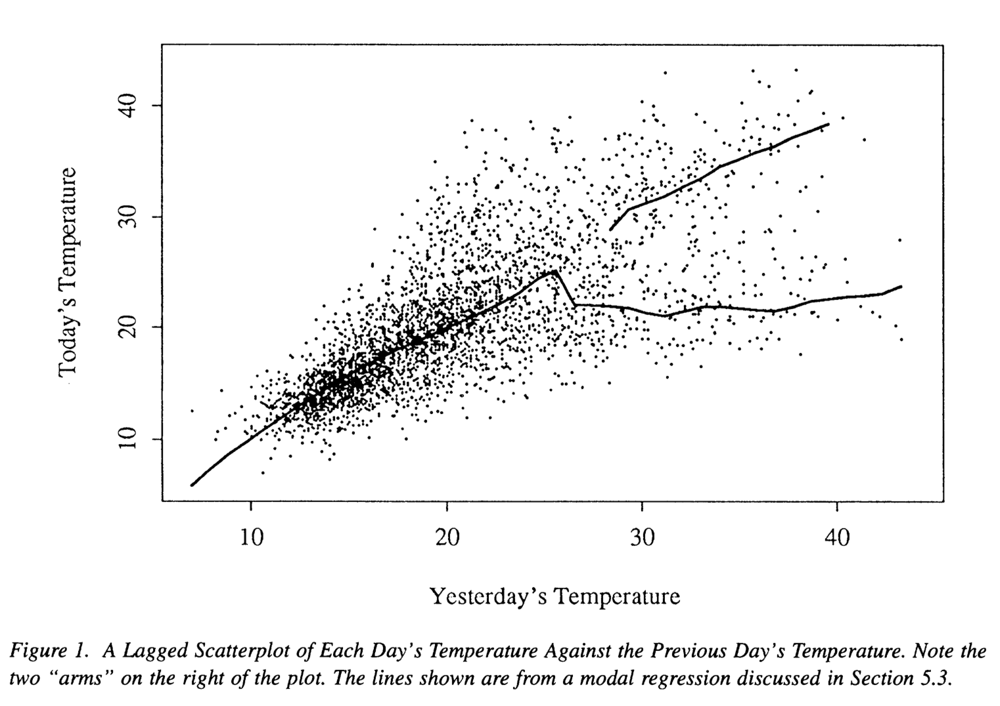
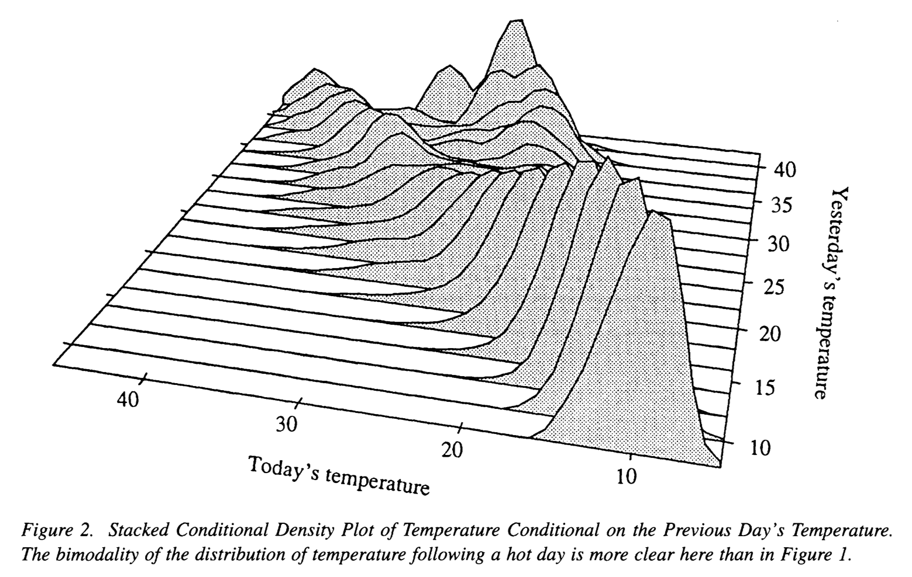
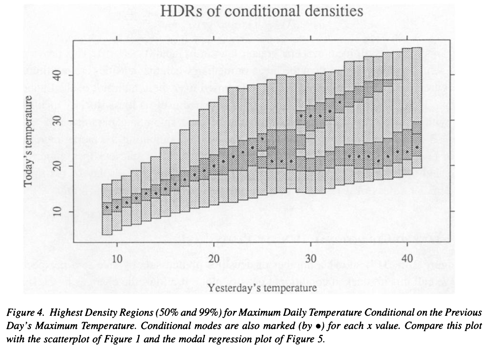
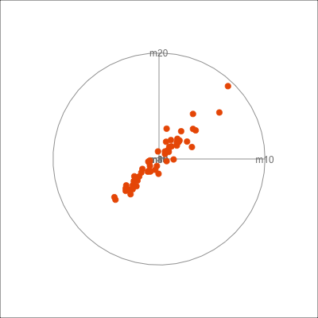
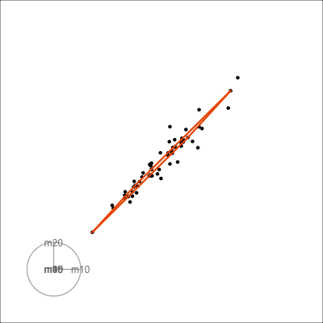

```{r setup, include = FALSE, echo=FALSE}
source("../setup.R")
```


```{r}
#| label: idea-image-data
#| eval: false
#| echo: false
# Code to generate data in idea image
set.seed(1135)
df2 <- tibble(id = 1:224) |>
  mutate(x = runif(n(), -10, 10),
         y = 0.5 * x + 3 * sin(x) + rnorm(n(), 0, 2))
df2 <- bind_rows(df2, tibble(id=225, x=1.5, y=-7))
ggplot(df2, aes(x, y)) +
  geom_point(colour="#D93F00", alpha=0.8, size=3) +
  xlim(c(-10.1, 10.1)) + ylim(c(-13, 13)) +
  theme(aspect.ratio = 0.8, 
        axis.title = element_blank(),
        axis.text = element_blank())

ggplot(df2, aes(x, y)) +
  geom_smooth(se = FALSE, color = "#D93F00",
     method = stats::loess, size = 3,
     method.args = list(span = 0.4)) +
  xlim(c(-10.1, 10.1)) + ylim(c(-13, 13)) +
  theme(aspect.ratio = 0.8, 
        axis.title = element_blank(),
        axis.text = element_blank())

ggplot(df2, aes(x, y)) +
  geom_smooth(se = FALSE, color = "#D93F00",
     method = stats::loess, size = 3,
     method.args = list(span = 0.4)) +
  xlim(c(-10.1, 10.1)) + ylim(c(-13, 13)) +
  theme(aspect.ratio = 0.8, 
        axis.title = element_blank(),
        axis.text = element_blank())

df2_lo <- loess(y~x, data=df2, span = 0.4)
df2 <- df2 |>
  mutate(.fitted = df2_lo$fitted,
         .resid = df2_lo$residuals)

ggplot(df2, aes(x, .fitted)) +
  geom_line(color = "#D93F00",
     linewidth = 3) +
  xlim(c(-10.1, 10.1)) + ylim(c(-13, 13)) +
  theme(aspect.ratio = 0.8, 
        axis.title = element_blank(),
        axis.text = element_blank())

ggplot(df2, aes(x, y)) +
  geom_point(colour="#D93F00", alpha=0.3, size=3) +
  geom_point(data=filter(df2, abs(.resid) > 5), colour="#D93F00", size=6) +
  xlim(c(-10.1, 10.1)) + ylim(c(-13, 13)) +
  theme(aspect.ratio = 0.8, 
        axis.title = element_blank(),
        axis.text = element_blank())
```

## Outline

- Different types of model fitting
- Decomposing data from model
    - fitted
    - residual
- Diagnostic calculations 
    - anomalies
    - leverage
    - influence

## Models can be used to re-focus the view of data {.transition-slide .center style="text-align: center;"}

## {background-image="../images/model-focus/model-focus.002.png" background-position="20% 80%" .center style="text-align: center;"}

## {background-image="../images/model-focus/model-focus.003.png" background-position="20% 80%" .center style="text-align: center;" count=FALSE}

::: {.absolute top=100 right=50 width=350}
[sharpening]{.monash-orange2}
:::

## {background-image="../images/model-focus/model-focus.004.png" background-position="20% 80%" .center style="text-align: center;" count=FALSE}

::: {.absolute top=100 right=50 width=350}
[what is missed]{.monash-orange2}
:::

## Different types of model fitting

:::: {.columns}
::: {.column}
The basic form for fitting a model with data (response $Y$ and predictors $X$) is:

$$
Y = f(X) + \varepsilon
$$

and $X$ could be include multiple variables, $X = (X_{1}, X_{2}, \dots, X_{p})$ where $p$ is the number of variables. We have a sample of $n$ observations, $y_i, x_{i1}, \dots x_{ip}, ~~~ i=1, \dots, n$. 
:::
::: {.column style="font-size: 70%;"}
- In a [parametric]{.monash-blue2} model, the form of $f$ is specified, e.g. $\beta_0 + \beta_1X_1 + \beta_2X_2 + \beta_3X_1X_2$, and one would estimate the parameters $\beta_0, \beta_1, \beta_2, \beta_3$.
    - Frequentist fitting assumes that parameters are fixed values. 
    - In a [Bayesian]{.monash-blue2} framework, the parameters are assumed to have a distribution, e.g. Gaussian.
- In a [non-parametric]{.monash-blue2} model, the form of $f$ is NOT specified but fitted from the data. May not have a specific functional form, and needs more data, typically. [Imposes less assumptions]{.monash-blue2}. Can be done in a Bayesian framework.
- Different [types of variables]{.monash-blue2} can change the model specification, e.g. binary or categorical $Y$, or temporal or spatial context.
- Different [model products]{.monash-blue2}, e.g. fitted values or residuals, after the fit [change the lens]{.monash-blue2} with which we view the data.
 
:::
::::

## Parametric regression {.transition-slide .center style="text-align: center;"}

## Specification

:::: {.columns}
::: {.column style="font-size: 90%;"}
Specify the 

- functional form, e.g. function form is has linear and quadratic terms

$$f(X) = \beta_0 + \beta_1 X + \beta_2 X^2$$

- distribution of errors, e.g. 

$$\varepsilon \sim N(0, \sigma^2)$$

Fitting results in:

- fitted values, $\widehat{y}$ ([sharpening]{.monash-blue2})
- residuals, $e = y-\widehat{y}$ ([what did we miss]{.monash-blue2})


:::

::: {.column style="font-size: 70%;"}

::: {.fragment}

```{r}
#| label: mtcars-poly-fit
#| code-fold: true
#| fig-width: 6
#| fig-height: 3
#| out-width: 80%
mtcars_fit <- lm(mpg~poly(hp, 2), data=mtcars)
mtcars_all <- augment(mtcars_fit, mtcars)
p1 <- ggplot(mtcars_all, aes(x=hp, y=mpg)) +
  geom_point() +
  ylim(c(10, 35)) +
  ggtitle("data")
p2 <- ggplot(mtcars_all, aes(x=hp, y=.fitted)) +
  geom_point() +
  ylab("f") +
  ylim(c(10, 35)) +
  ggtitle("model")
p1 + p2 + plot_layout(ncol=2)

mtcars_coefs <- tidy(mtcars_fit)
mtcars_stats <- glance(mtcars_fit)
mtcars_coefs
mtcars_stats
```
:::

:::
::::

## Diagnostics [(1/3)]{.smallest}

:::: {.columns}
::: {.column width=40%}
Residuals, $e = y-\widehat{y}$ (*what doesn't the fitted model see?*)

- Should be consistent with a sample from the [specified error model]{.monash-blue2}
- Should have [no relationship]{.monash-blue2} with the response variable
:::
::: {.column style="font-size: 80%; width: 60%;"}

::: {.panel-tabset}

## Lineup

```{r}
#| label: mtcars-lineup-hist
#| code-fold: true
#| fig-width: 6
#| fig-height: 6
#| out-width: 70%
set.seed(1026)
ggplot(lineup(null_dist(".resid", "norm"), n=12, true=mtcars_all), 
       aes(x=.resid)) +
  geom_histogram(binwidth=1, colour="white") +
  facet_wrap(~.sample, ncol=4) +
  theme(axis.title = element_blank(),
        axis.text = element_blank())
```

## Normal?

```{r}
#| label: mtcars-normal-diagnostics
#| code-fold: true
#| fig-width: 6
#| fig-height: 6
#| out-width: 70%
p3 <- ggplot(mtcars_all, aes(x=.resid)) +
  geom_histogram(binwidth=1, colour="white") 
p4 <- ggplot(mtcars_all, aes(sample=.resid)) +
  geom_qq_line() +
  geom_qq() 
p5 <- ggplot(mtcars_all, aes(x=1, y=.resid)) +
  geom_quasirandom() 
p6 <- ggplot(mtcars_all, aes(x=1, y=.resid)) +
  geom_violin(fill="#D93F00", colour="white", 
              draw_quantiles=c(0.25, 0.5, 0.75)) 

p3 + p4 + p5 + p6 + plot_layout(ncol=2)

```

## Lineup

```{r}
#| label: mtcars-lineup-resid
#| code-fold: true
#| fig-width: 6
#| fig-height: 6
#| out-width: 70%
set.seed(1058)
ggplot(lineup(null_dist(".resid", "norm"), n=12, true=mtcars_all), 
       aes(x=hp, y=.resid)) +
  geom_point() +
  facet_wrap(~.sample, ncol=4) +
  theme(axis.title = element_blank(),
        axis.text = element_blank())
```

## Relationship?

```{r}
#| label: mtcars-resid-vs-hp
#| code-fold: true
#| fig-width: 8
#| fig-height: 5
#| out-width: 70%
p7 <- ggplot(mtcars_all, aes(x=hp, y=.resid)) +
  geom_point() +
  ylab("e") +
  ylim(c(-3, 3)) +
  ggtitle("residuals")
mt_full_fit <- tibble(hp = seq(50, 340, 10))
mt_full_fit <- mt_full_fit |>
                mutate(mpg = predict(mtcars_fit, mt_full_fit))
p8 <- ggplot(mtcars_all, aes(x=hp, y=mpg)) +
  geom_point() +
  geom_line(data=mt_full_fit, colour="#D93F00", linewidth=2) +
  ylim(c(10, 35)) +
  ggtitle("data+f")

p7 + p8 + plot_layout(ncol=2)

```


:::
:::
::::

## Diagnostics [(2/3)]{.smallest}

:::: {.columns}
::: {.column style="font-size: 70%;"}

### Leverage 

* The matrix $\mathbf{H} = \mathbf{X}(\mathbf{X}^\top\mathbf{X})^{-1}\mathbf{X}^\top$ is referred to as the [**hat matrix**]{.monash-blue}.
* The $i$-th diagonal element of $\mathbf{H}$, $h_{ii}$, is called the [**leverage**]{.monash-blue} of the $i$-th observation.
* Leverages are always between zero and one,
$$0 \leq h_{ii} \leq 1.$$
* Notice that leverages are not dependent on the response!
* Points with high leverage can exert a lot of influence on the parameter estimates

### Studentized residuals

* In order to obtain residuals with equal variance, many texts recommend using the [**studentised residuals**]{.monash-blue}
$$e_i^* = \dfrac{e_i} {\widehat{\sigma} \sqrt{1 - h_{ii}}}$$ for diagnostic checks.


:::
::: {.column style="font-size: 70%;"}

### Cook's distance

* [Cook's distance]{.monash-blue}, $D$, is another measure of influence: 
\begin{eqnarray*}
D_i &=& \dfrac{(\widehat{\boldsymbol{\beta}}- \widehat{\boldsymbol{\beta}}_{[-i]})^\top Var(\widehat{\boldsymbol{\beta}})^{-1}(\widehat{\boldsymbol{\beta}}- \widehat{\boldsymbol{\beta}}_{[-i]})}{p}\\
&=&\frac{e_i^2 h_{ii}}{(1-h_{ii})^2p\widehat\sigma^2},
\end{eqnarray*}
where $p$ is the number of elements in $\boldsymbol{\beta}$, $\widehat{\boldsymbol{\beta}}_{[-i]}$ and $\widehat Y_{j[-i]}$ are least squares estimates and the fitted value obtained by fitting the model ignoring the $i$-th data point $(\boldsymbol{x}_i,Y_i)$, respectively.

:::
::::

## Activity: Hand-calculate the diagnostics {.activity-slide}

::: {.callout-tip title="Your turn"}
Use these 5 points from `mtcars` (`mpg` on `hp`), and the formulas from the previous slide, to hand-calculate the diagnostics for the simple linear model `mpg ~ hp`.

```{r}
#| label: mtcars-hand-calc-data
#| echo: false
mtcars_small <- mtcars[1:5, c("mpg", "hp")]
mtcars_small
```

1. Build the design matrix $\mathbf{X}$ (a column of 1's and the `hp` column), and compute the hat matrix $\mathbf{H} = \mathbf{X}(\mathbf{X}^\top\mathbf{X})^{-1}\mathbf{X}^\top$. Read off the leverages $h_{ii}$ from the diagonal.
2. Fit the model and compute the residuals $e_i = y_i - \widehat y_i$, and $\widehat\sigma = \sqrt{\sum_i e_i^2 / (n-p)}$ with $n=5$, $p=2$.
3. Compute the studentised residual $e_i^*$ and Cook's distance $D_i$ for each point.
4. Which point has the highest leverage? Does it also have the largest Cook's distance? Why or why not?
5. Check your answers against R's `hatvalues()`, `rstandard()` and `cooks.distance()`.
:::

```{r}
#| label: mtcars-hand-calc-activity
#| eval: false
#| echo: false
X <- cbind(1, mtcars_small$hp)
y <- mtcars_small$mpg

H <- X %*% solve(t(X) %*% X) %*% t(X)
h <- diag(H)

mtcars_fit_small <- lm(mpg ~ hp, data = mtcars_small)
e <- residuals(mtcars_fit_small)
n <- 5
p <- 2
sigma_hat <- sqrt(sum(e^2) / (n - p))

e_star <- e / (sigma_hat * sqrt(1 - h))
cooksd <- (e^2 * h) / ((1 - h)^2 * p * sigma_hat^2)

data.frame(hp = mtcars_small$hp, leverage = h,
           studentised = e_star, cooksd = cooksd)

# Check against R
data.frame(hatvalues(mtcars_fit_small),
           rstandard(mtcars_fit_small),
           cooks.distance(mtcars_fit_small))
```

```{r}
#| label: mtcars-hand-calc-countdown
#| echo: false
countdown::countdown(8, 30)
```

## Diagnostics [(3/3)]{.smallest}


```{r}
#| label: mtcars-diagnostic-measures
#| code-fold: true
mtcars_all <- mtcars_all |>
  mutate(id = 1:n())
p10 <- ggplot(mtcars_all, aes(x=id, y=.hat, label=id)) +
  geom_point() +
  labs(title="leverage")
p11 <- ggplot(mtcars_all, aes(x=id, y=.cooksd, label=id)) +
  geom_point() +
  labs(title="cooks d") 
p12 <- ggplot(mtcars_all, aes(x=.resid, y=.std.resid, label=id)) +
  geom_point() +
  labs(title="studentised residuals")
```

:::: {.columns}
::: {.column width=30%}
```{r}
#| label: mtcars-leverage-plotly
#| echo: false
#| fig-width: 3
#| fig-height: 3
#| fig-show: hold
ggplotly(p10, width=400, height=400) |> config(displayModeBar = FALSE)
```
:::
::: {.column width=30%}
```{r}
#| label: mtcars-cooksd-plotly
#| echo: false
#| fig-width: 3
#| fig-height: 3
#| fig-show: hold
ggplotly(p11, width=400, height=400) |> config(displayModeBar = FALSE)
```
:::
::: {.column width=30%}
```{r}
#| label: mtcars-studentised-plotly
#| echo: false
#| fig-width: 3
#| fig-height: 3
#| fig-show: hold
ggplotly(p12, width=400, height=400) |> config(displayModeBar = FALSE)
```

:::
::::

## Simulation

:::: {.columns}
::: {.column}

Generate response values for un-collected predictor values

```{r}
#| label: mtcars-new-hp-values
#| eval: false
mt_full_fit <- tibble(hp = seq(50, 340, 10))
mt_full_fit <- mt_full_fit |>
                mutate(mpg = predict(mtcars_fit, mt_full_fit))
```

```{r}
#| label: mtcars-new-hp-plot
#| echo: false
#| fig-width: 4
#| fig-height: 4
#| out-width: 50%
ggplot(mt_full_fit, aes(x=hp, y=mpg)) +
  geom_point(colour="#D93F00") +
  ylim(c(10, 35)) 
``` 

:::
::: {.column}

Simulate new samples

::: {.panel-tabset}

## 1

```{r}
#| label: mtcars-sim-1
#| code-fold: true
#| fig-width: 6
#| fig-height: 4
#| out-width: 70%
set.seed(1249)
mt_sample1 <- tibble(hp = runif(nrow(mtcars), 50, 340),
                     e = rnorm(nrow(mtcars), sd = mtcars_stats$sigma))
mt_sample1 <- mt_sample1 |>
                mutate(mpg = predict(mtcars_fit, mt_sample1) + e,
                       type = "sim") |>
  select(hp, mpg, type)
mtcars_sub <- mtcars |>
  select(hp, mpg) |>
  mutate(type = "data")
mt_sample1 <- bind_rows(mt_sample1, mtcars_sub)

ggplot(mt_sample1, aes(x=hp, y=mpg, colour=type)) +
  geom_point() +
  scale_color_discrete_divergingx(palette = "Zissou 1") +
  ylim(c(10, 35)) 

```

## 2

```{r}
#| label: mtcars-sim-2
#| code-fold: true
#| fig-width: 6
#| fig-height: 4
#| out-width: 70%
set.seed(1250)
mt_sample2 <- tibble(hp = runif(nrow(mtcars), 50, 340),
                     e = rnorm(nrow(mtcars), sd = mtcars_stats$sigma))
mt_sample2 <- mt_sample2 |>
                mutate(mpg = predict(mtcars_fit, mt_sample2) + e,
                       type = "sim") |>
  select(hp, mpg, type)
mtcars_sub <- mtcars |>
  select(hp, mpg) |>
  mutate(type = "data")
mt_sample2 <- bind_rows(mt_sample2, mtcars_sub)

ggplot(mt_sample2, aes(x=hp, y=mpg, colour=type)) +
  geom_point() +
  scale_color_discrete_divergingx(palette = "Zissou 1") +
  ylim(c(10, 35)) 
```

## 3

```{r}
#| label: mtcars-sim-3
#| code-fold: true
#| fig-width: 6
#| fig-height: 4
#| out-width: 70%
set.seed(1350)
mt_sample3 <- tibble(hp = runif(nrow(mtcars), 50, 340),
                     e = rnorm(nrow(mtcars), sd = mtcars_stats$sigma))
mt_sample3 <- mt_sample3 |>
                mutate(mpg = predict(mtcars_fit, mt_sample3) + e,
                       type = "sim") |>
  select(hp, mpg, type)
mtcars_sub <- mtcars |>
  select(hp, mpg) |>
  mutate(type = "data")
mt_sample3 <- bind_rows(mt_sample3, mtcars_sub)

ggplot(mt_sample3, aes(x=hp, y=mpg, colour=type)) +
  geom_point() +
  scale_color_discrete_divergingx(palette = "Zissou 1") +
  ylim(c(10, 35)) 
```

:::

:::
::::

## What can go wrong with parametric model? {.transition-slide .center style="text-align: center;"}

## Wrong specification

:::: {.columns}
::: {.column style="font-size: 80%;"}

Specify function form is has only linear term

$$f(X) = \beta_0 + \beta_1 X$$

```{r}
#| label: mtcars-linear-misspecified
#| code-fold: true
#| fig-width: 6
#| fig-height: 4
#| out-width: 80%
mtcars_fit2 <- lm(mpg~hp, data=mtcars)
mtcars_all2 <- augment(mtcars_fit2, mtcars)
sp1 <- ggplot(mtcars_all2, aes(x=hp, y=mpg)) +
  geom_point() +
  geom_point(aes(x=hp, y=.fitted), colour="#D93F00") + 
  ylim(c(10, 35)) +
  ggtitle("data+model")
sp2 <- ggplot(mtcars_all2, aes(x=hp, y=.resid)) +
  geom_hline(yintercept=0, colour="grey60") +
  geom_point() +
  ylab("e") +
  ggtitle("residuals")
sp1 + sp2 + plot_layout(ncol=2)
```

:::
::: {.column style="font-size: 70%;"}

Polynomial

```{r}
#| label: mtcars-poly-summary
#| echo: false
tidy(mtcars_fit)
glance(mtcars_fit)
```

Linear

```{r}
#| label: mtcars-linear-summary
#| echo: false
tidy(mtcars_fit2)
glance(mtcars_fit2)
```


:::
::::


## Extrapolating

:::: {.columns}
::: {.column}

Generate response values for un-collected predictor values OUTSIDE of domain of collected data, can produce [HALLUCINATIONS]{.monash-blue2}.

```{r}
#| label: mtcars-extrapolation-data
#| code-fold: true
mtcars_fit3 <- lm(mpg~poly(hp, 5), data=mtcars)
mtcars_all3 <- augment(mtcars_fit3, mtcars)
mtcars_stats3 <- glance(mtcars_fit3)

set.seed(129)
mt_extrap <- tibble(hp = seq(250, 450, 10),
                    e = rnorm(length(hp), sd=mtcars_stats3$sigma))
mt_extrap <- mt_extrap |>
                mutate(mpg = predict(mtcars_fit3, mt_extrap) + e) |>
  mutate(type = "new") |>
  select(-e)
mt_extrap <- bind_rows(mt_extrap, mtcars_sub)
```


:::
::: {.column}

```{r}
#| label: mtcars-extrapolation-plot
#| echo: false
#| fig-width: 4
#| fig-height: 4
#| out-width: 100%
ggplot(mt_extrap, aes(x=hp, y=mpg, colour=type)) +
  geom_point() +
  scale_color_discrete_divergingx(palette = "Zissou 1") 
``` 

:::
::::


## Multiple variables

:::: {.columns}
::: {.column}

Missing terms

```{r}
#| label: mtcars-gear-scatter
#| echo: false
#| out-width: 80%
mtcars <- mtcars |>
  mutate(am = factor(am, labels = c("auto", "manual")),
         cyl = factor(cyl),
         gear = factor(gear))
ggplot(mtcars, aes(x=hp, y=mpg, colour=gear)) +
  geom_point() + 
  scale_color_discrete_divergingx(palette="Zissou 1") 
```

```{r}
#| label: mtcars-gear-interaction-fit
#| code-fold: true
mtcars_fit4 <- lm(mpg~hp+gear, data=mtcars)
mtcars_all4 <- augment(mtcars_fit4, mtcars)
mtcars_coefs4 <- tidy(mtcars_fit4)
mtcars_fit5 <- lm(mpg~hp*gear, data=mtcars)
mtcars_all5 <- augment(mtcars_fit5, mtcars)
mtcars_coefs5 <- tidy(mtcars_fit5)
ip1 <- ggplot(mtcars_all4, aes(x=hp, y=.fitted, colour=gear)) +
  geom_point() +
  scale_color_discrete_divergingx(palette="Zissou 1") +
  ggtitle("No interaction") +
  theme(legend.position = "None")
ip2 <- ggplot(mtcars_all5, aes(x=hp, y=.fitted, colour=gear)) +
  geom_point() +
  scale_color_discrete_divergingx(palette="Zissou 1") +
  ggtitle("With interaction") +
  theme(legend.position = "None")
```


:::
::: {.column style="font-size: 70%;"}

```{r}
#| label: mtcars-gear-interaction-plot
#| echo: false
#| fig-width: 8
#| fig-height: 4
#| out-width: 80%
ip1 + ip2 + plot_layout(ncol=2)
```

```{r}
#| label: mtcars-gear-coefs
#| echo: false
mtcars_coefs4
mtcars_coefs5
```

:::
::::

## Activity: Polynomial interaction {.activity-slide}

::: {.callout-tip title="Your turn"}
1. Fit two polynomial models (degree 2) of `mpg` on `hp`, one without and one with an interaction with `am`: `lm(mpg~poly(hp, 2)+am, data=mtcars)` and `lm(mpg~poly(hp, 2)*am, data=mtcars)`.
2. Plot the fitted values from each model against `hp`, coloured by `am`, as done for the linear model on the previous slide.
3. Compare the coefficient tables for the two models. How does allowing an interaction change the shape of the fitted curves, compared to the linear case? Is the interaction term necessary or useful for this data?
:::

```{r}
#| label: mtcars-poly-interaction
#| eval: false
#| cide-fold: true
mtcars_fit_poly1 <- lm(mpg~poly(hp, 2)+am, data=mtcars)
mtcars_all_poly1 <- augment(mtcars_fit_poly1, mtcars)
tidy(mtcars_fit_poly1)

mtcars_fit_poly2 <- lm(mpg~poly(hp, 2)*am, data=mtcars)
mtcars_all_poly2 <- augment(mtcars_fit_poly2, mtcars)
tidy(mtcars_fit_poly2)

ggplot(mtcars_all_poly1, aes(x=hp, y=.fitted, colour=am)) +
  geom_point() +
  ggtitle("No interaction")

ggplot(mtcars_all_poly2, aes(x=hp, y=.fitted, colour=am)) +
  geom_point() +
  ggtitle("With interaction")
```

```{r}
#| label: poly-interaction-countdown
#| echo: false
countdown::countdown(5, 01)
```

## Non-parametric model {.transition-slide .center style="text-align: center;"}

## Smoothing splines

:::: {.columns}
::: {.column style="font-size: 80%;"}

We've seen `loess`, which fits a linear model in a sliding window over predictor, where `span` controls size of window.

```{r}
#| label: mtcars-loess-fit
#| code-fold: true
#| fig-width: 4
#| fig-height: 4
#| out-width: 50%
mtcars_fit6 <- loess(mpg~hp, data=mtcars, degree=1, span=0.2)
mtcars_fit7 <- loess(mpg~hp, data=mtcars, degree=1, span=0.5)
mtcars_lo <- mtcars |>
  mutate(fit6 = mtcars_fit6$fitted,
         fit7 = mtcars_fit7$fitted)
mtcars_lop <- tibble(hp = seq(50, 340, 5))
mtcars_lop <- mtcars_lop |>
                mutate(mpg6 = predict(mtcars_fit6, mtcars_lop),
                       mpg7 = predict(mtcars_fit7, mtcars_lop))

ggplot(data=mtcars_lo, aes(x=hp, y=mpg)) +
  geom_point() +
  geom_line(data=mtcars_lop, aes(x=hp, y=mpg6), colour="#D93F00") +
  geom_line(data=mtcars_lop, aes(x=hp, y=mpg7), colour="#027EB6") 
```

:::
::: {.column style="font-size: 70%;"}

Smoothing splines, provide more advanced technique, and stability. 

```{r}
#| label: mtcars-gam-fit
#| code-fold: true
#| fig-width: 4
#| fig-height: 4
#| out-width: 50%
mtcars_fit8 <- gam(mpg~s(hp, bs="cr", k=3, m=1), data=mtcars, 
                   knots=list(seq(90, 300, length=3)))
mtcars_fit9 <- gam(mpg~s(hp, bs="cr", k=10, m=1), data=mtcars, 
                   knots=list(seq(90, 300, length=3)))
mtcars_gam <- mtcars |>
  mutate(fit8 = mtcars_fit8$fitted.values,
         fit9 = mtcars_fit9$fitted.values)
mtcars_gamp <- tibble(hp = seq(50, 450, 5))
mtcars_gamp <- mtcars_gamp |>
                mutate(mpg8 = predict(mtcars_fit8, mtcars_gamp),
                       mpg9 = predict(mtcars_fit9, mtcars_gamp))

ggplot(data=mtcars_gam, aes(x=hp, y=mpg)) +
  geom_point() +
  geom_line(data=mtcars_gamp, aes(x=hp, y=mpg8), colour="#D93F00") +
  geom_line(data=mtcars_gamp, aes(x=hp, y=mpg9), colour="#027EB6") 
```

And are used to fit non-linear models to multiple predictors. 

:::
::::

## Logistic regression

:::: {.columns}
::: {.column style="font-size: 70%;"}

* Not all parametric models assume normally distributed errors nor continuous responses.
* Logistic regression models the relationship between a set of explanatory  variables $(x_{i1}, ..., x_{ik})$ and a set of [**binary outcomes**]{.monash-blue2} $Y_i$ for $i = 1, ..., n$.
* We assume that $Y_i \sim B(1, p_i)\equiv Bernoulli(p_i)$ and the model is given by 

$$\text{logit}(p_i) = \text{ln}\left(\dfrac{p_i}{1 - p_i}\right) = \beta_0 + \beta_1x_{i1} + ... + \beta_k x_{ik}.$$

* Taking the exponential of both sides and rearranging we get
$$p_i = \dfrac{1}{1 + e^{-(\beta_0 + \beta_1x_{i1} + ... + \beta_k x_{ik})}}.$$

* The function $f(p) = \text{ln}\left(\dfrac{p}{1 - p}\right)$ is called the [**logit**]{.monash-blue2} function, continuous with range $(-\infty, \infty)$, and if $p$ is the probablity of an event, $f(p)$ is the log of the odds.

:::
::: {.column style="font-size: 90%;"}


```{r}
#| label: mtcars-logistic-vs-loess
#| code-fold: true
#| fig-width: 6
#| fig-height: 3
#| out-width: 100%
mtcars_ordered <- mtcars |>
  mutate(ami = as.numeric(am)-1) |>
  arrange(mpg)
mtcars_am_fit1 <- loess(ami~mpg, data=mtcars_ordered, degree=0, span=0.7)
mtcars_am_lo <- mtcars_ordered |>
  mutate(fit1 = mtcars_am_fit1$fitted)
lg1 <- ggplot(mtcars_ordered, aes(x=mpg, y=ami)) +
  geom_point() +
  geom_point(data=mtcars_am_lo, aes(x=mpg, y=fit1), colour="#D93F00") +
  geom_line(data=mtcars_am_lo, aes(x=mpg, y=fit1), colour="#D93F00") +
  ylab("automatic") +
  ggtitle("Loess")

mtcars_am_fit2 <- glm(ami~mpg, data=mtcars_ordered, family = binomial(link = "logit"))
mtcars_am_lo <- mtcars_am_lo |>
  mutate(fit2 = mtcars_am_fit2$fitted.values)
lg2 <- ggplot(mtcars_ordered, aes(x=mpg, y=ami)) +
  geom_point() +
  geom_point(data=mtcars_am_lo, aes(x=mpg, y=fit2), colour="#D93F00") +
  geom_line(data=mtcars_am_lo, aes(x=mpg, y=fit2), colour="#D93F00") +
  ylab("automatic") +
  ggtitle("Logistic")

lg1 + lg2 + plot_layout(ncol=2)
```

Slide a window and compute average (proportion) using loess, vs logistic function. 

:::
::::


## Time series {.transition-slide .center style="text-align: center;"}

## Trend and seasonality

:::: {.columns}
::: {.column style="font-size: 80%; width: 35%;"}

```{r}
#| label: co2-data-wrangle
#| code-fold: true
co2 <- read_csv("../data/CO2-monthly.csv") |>
  mutate(date = dmy(date))
co2_long <- co2 |>
  pivot_longer(ljo:spo, names_to = "stn", values_to = "co2") |>
  filter(stn %in% c("ptb", "ljo", "spo", "mlf")) |>
  mutate(stn = factor(stn, levels = c("ptb", "ljo", "mlf", "spo"))) |>
  filter(!is.na(co2)) |>
  filter(co2 < 430)
co2_p1 <- ggplot(co2_long, aes(x=date, y=co2, colour=stn)) +
  geom_point() +
  facet_wrap(~stn, ncol=2) +
  theme(legend.position="none") +
  ylim(c(330, 430)) +
  theme(aspect.ratio = 0.5)

co2_fit <- co2_long |>
  mutate(time = as.numeric(date)-7304) |>
  nest(dat = -stn) |>
  mutate(mod_trend = map(dat, ~lm(co2~time+I(time^2), data=.x)),
         mod_season = map(dat, ~lm(co2~time+I(time^2)+month, data=.x)),
        coef_trend = map(mod_trend, tidy),
        coef_seasonal = map(mod_season, tidy),
        fit_trend = map(mod_trend, augment),
        fit_season = map(mod_season, augment)) |>
    select(stn, starts_with('fit')) |> 
    pivot_longer(
        cols = starts_with('fit')
    ) |>
    unnest(value)
co2_p2 <- co2_fit |>
  filter(name == "fit_trend") |>
  ggplot(aes(x=time, y=.fitted, colour=stn)) +
  geom_point() +
  ylim(c(330, 430))

co2_p3 <- co2_fit |>
  filter(name == "fit_season") |>
  mutate(year = time %/% 356 + 1990) |>
  group_by(stn, year) |>
  mutate(.fitted_seas = .fitted - mean(.fitted, na.rm=TRUE)) |>
  ggplot(aes(x=time, y=.fitted_seas, colour=stn)) +
  geom_line() + 
  facet_wrap(~stn, ncol=2) +
  theme(aspect.ratio=0.5)
```

:::

::: {.column width=65%}
::: {.panel-tabset}

## Data

```{r}
#| label: co2-plot-data
#| echo: false
#| fig-width: 8
#| fig-height: 6
#| out-width: 70%
co2_p1
```

## Trend 

```{r}
#| label: co2-plot-trend
#| echo: false
#| fig-width: 5
#| fig-height: 5
#| out-width: 60%
co2_p2 + theme(legend.position = "none")
```


## Seasonality

```{r}
#| label: co2-plot-seasonality
#| echo: false
#| fig-width: 8
#| fig-height: 6
#| out-width: 80%
co2_p3 + ylab("De-trended fit")
```

:::
:::
::::

[Data from [Global CO2 monitoring stations](https://gml.noaa.gov/dv/data/index.php?parameter_name=Carbon%2BDioxide)]{.smallest}

## Exploring lags

Melbourne's temperature, from high to low!

:::: {.columns}
::: {.column width=33%}

:::
::: {.column width=33%}

:::

::: {.column width=33%}

:::
::::

Today plotted vertically, yesterday plotted horizontally. Different types of plots are different models applied to the data (lags).

[Hyndman, Bashtannyk, Grunwald (1996)]{.smallest}

## High-dimensions {.transition-slide .center style="text-align: center;"}

## Groups

:::: {.columns}
::: {.column}

<center>
Data


</center>

A little fuzzy. 

:::
::: {.column}
::: {.fragment}
<center>
Model view


</center>

Clearer view. Misses some quirks.
:::
:::
::::

## Relationships

:::: {.columns}
::: {.column}

```{r}
#| label: track-grand-tour
#| eval: false
#| echo: false
track <- read_csv(here::here("data/womens_track.csv"))
animate_xy(track[,1:7], col="#EC5C00",
             cex=2,
             rescale=TRUE,
             half_range = 1.4)
render_gif(track[,1:7], 
           grand_tour(),
           display_xy(col="#EC5C00",
             cex=2,
             half_range = 1.4),
           rescale=TRUE,
           gif_file = "images/track.gif",
           apf = 1/30,
           frames = 500,
           width = 400, 
           height = 400)
```

<center>
{width=600}
</center>

:::
::: {.column}

```{r}
#| label: track-pca-model
#| eval: false
#| echo: false
track_std <- track |>   
  mutate_if(is.numeric, function(x) (x-
      mean(x, na.rm=TRUE))/
      sd(x, na.rm=TRUE))
track_std_pca <- prcomp(track_std[,1:7], 
               scale = FALSE, 
               retx=TRUE)
track_model <- pca_model(track_std_pca, d=2, s=2)
track_all <- rbind(track_model$points, track_std[,1:7])
animate_xy(track_all, edges=track_model$edges,
           edges.col="#EC5C00", 
           edges.width=3, 
           axes="bottomleft",
           half_range = 6)
render_gif(track_all, 
           grand_tour(), 
           display_xy(
                      edges=track_model$edges, 
                      edges.col="#EC5C00", 
                      edges.width=3, 
                      axes="bottomleft",
                      half_range = 6),
           gif_file="images/track_model.gif",
           frames=500,
           width=400,
           height=400,
           loop=FALSE)
```

::: {.fragment}
<center>
{width=600}
</center>
:::

:::
::::

## Activity: Reshape ratings to long form {.activity-slide}

::: {.callout-tip title="Your turn"}
The `french_fries` data (`../data/french_fries.rda`) records sensory ratings of french fries over a 10-week experiment, on five scales: `potato`, `buttery`, `grassy`, `rancid`, `painty`.

1. Load the data with `load("../data/french_fries.rda")` and inspect it with `glimpse()`.
2. Convert it to long form with `pivot_longer()`, creating a `type` column (from the scale names) and a `rating` column (from the scale values).
3. Convert `time` to numeric, so weeks can be treated as a continuous predictor.
:::

```{r}
#| label: ff-reshape-activity
#| eval: false
library(tidyr)
load("../data/french_fries.rda")
glimpse(french_fries)

ff_long <- french_fries |>
  pivot_longer(potato:painty, names_to = "type", values_to = "rating") |>
  mutate(time = as.numeric(time))
head(ff_long)
```

```{r}
#| label: ff-reshape-countdown
#| echo: false
countdown::countdown(4, 30)
```

## Activity: Raw view of ratings by week {.activity-slide}

::: {.callout-tip title="Your turn"}
1. Using `ff_long`, plot `rating` against `time`, coloured by `type`, with `geom_point()` and `geom_smooth()`, faceted by `type`.
2. How easy is it to tell, from this raw/noisy view, whether ratings change over the 10 weeks for each scale?
:::

```{r}
#| label: ff-raw-view-activity
#| eval: false
ggplot(ff_long, aes(x = time, y = rating, colour = type)) +
  geom_point(size = 0.75) +
  geom_smooth() +
  facet_wrap(~type, ncol = 5) +
  theme(legend.position = "none")
```

```{r}
#| label: ff-raw-view-countdown
#| echo: false
countdown::countdown(4, 30)
```

## Activity: Sharpen ratings with a model {.activity-slide}

::: {.callout-tip title="Your turn"}
1. Fit a linear model of `rating` on `time` and `type`, allowing a different trend for each scale: `lm(rating ~ type*time - 1, data = ff_long)`.
2. Extract the fitted values (e.g. with `augment()`), and plot the fitted rating against `time`, coloured by `type`.
3. Compare this model view to the raw view on the previous slide -- what has been [sharpened]{.monash-blue2}? What variation has been [hidden]{.monash-blue2} in the process?
:::

```{r}
#| label: ff-model-activity
#| eval: false
library(broom)
ff_fit <- lm(rating ~ type*time - 1, data = ff_long)
ff_fitted <- augment(ff_fit)

ggplot(ff_fitted, aes(x = time, y = .fitted, colour = type)) +
  geom_line(linewidth = 1)
```

```{r}
#| label: ff-model-countdown
#| echo: false
countdown::countdown(5, 30)
```

The model trades the noise of individual ratings for a clear picture of how each scale trends over the 10 weeks -- a [sharpened]{.monash-blue2} view, at the cost of hiding rater-to-rater and replicate variability.

## Take-aways

- Models provide different lenses for extracting the patterns in the data
    - Sharpen 
    - Exaggerate 
    - Hallucinate 
- Form a decomposition of the observed values into different strata
- Provide a multitude of other numerical quantities with which to see various aspects of the data.
- We are already using models, all the time, when making plots. 

## Resources

- Cook & Weisberg (1994) An Introduction to Regression Graphics
- Belsley, Kuh and Welsch (1980). Regression Diagnostics
- Hyndman, Bashtannyk, Grunwald (1996) Estimating and Visualizing Conditional Densities
